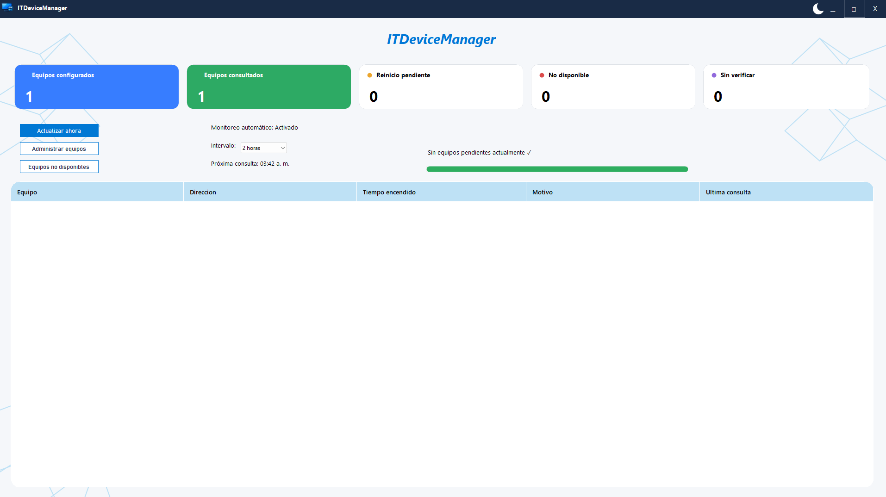
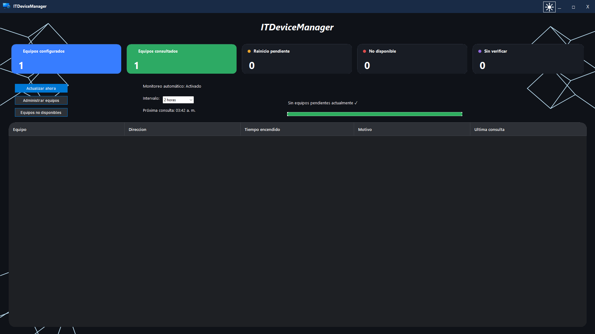
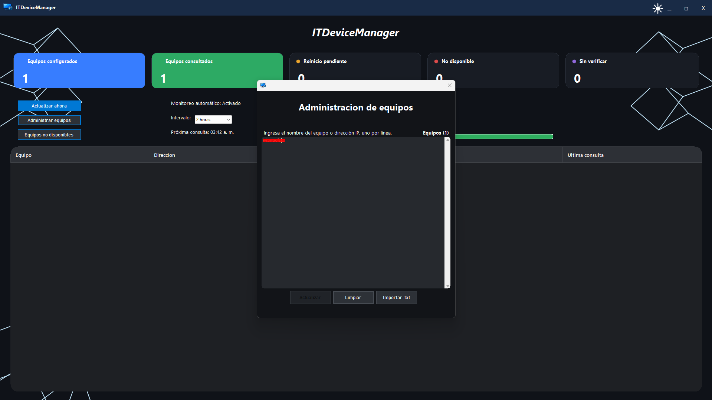
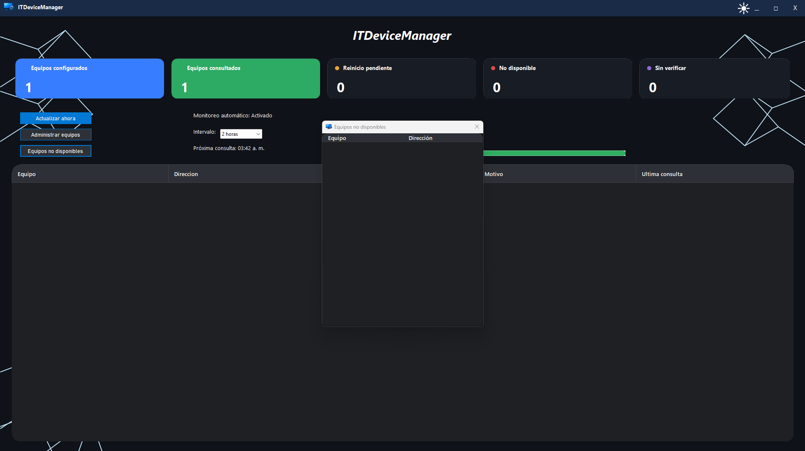

# ITDeviceManager

**English** | **Español**

> **Project status:** Preview / testing. The first portable build has been tested on the development computer. Testing on a second computer and a full automatic monitoring interval is still pending.

## Overview

ITDeviceManager is a Windows desktop application built with **C#**, **.NET 10**, and **Windows Forms** to support Windows device monitoring in IT support environments. It lets technicians manage devices by hostname or IP address, check availability, identify pending restarts, and run manual or scheduled diagnostics.

## Features

- Manage a device list by hostname or IP address; import entries from a `.txt` file.
- Save the device list locally as JSON, under the current Windows user's local application data directory.
- Query Windows devices using **WMI** and inspect remote Windows Registry indicators associated with pending restarts.
- Display summary cards for configured devices, checked devices, pending restarts, unavailable devices, and devices whose status could not be verified.
- Review pending-restart devices and unavailable devices in dedicated views.
- Start a scan manually or schedule scans at **2, 4, 6, 8, or 12-hour** intervals (default: 6 hours).
- Switch between light and dark themes.
- Monitor without installing an agent or service on target devices.

## Tech stack

- C# / .NET 10
- Windows Forms (WinForms)
- Windows Management Instrumentation (WMI)
- Windows Registry
- JSON (`System.Text.Json`)

## Screenshots

### Light Theme

### Dark Theme

### Device Management

### Unavailable Devices

## Requirements and limitations

- **Windows x64** for the current portable build (`win-x64`).
- The published build is **self-contained** and does not require a separate .NET runtime installation.
- Remote checks require appropriate Windows permissions, network access, and availability of the relevant WMI and Registry services/settings on target devices.
- A device that cannot be contacted or whose status cannot be verified is not necessarily pending a restart.
- The monitoring interval returns to the **6-hour default** when the application restarts.
- The app is currently a **preview**, not yet validated for production deployment.

## Getting started (portable preview)

1. Obtain the `ITDeviceManager.exe` file from a trusted project release or the project's publication output.
2. Copy it to a folder on a Windows x64 computer.
3. Run `ITDeviceManager.exe`.
4. Open **Manage Devices** and enter a hostname or IP address per line, or import a `.txt` list.
5. Select **Update** to save the device list and start a scan.
6. Review the dashboard and use **Update Now** for a manual scan.

**Configuration storage:** `%LOCALAPPDATA%\ITDeviceManager\devices.json`. Device lists are stored separately for each Windows user account.

> **Security note:** Only monitor devices you are authorized to administer. Windows security policies and endpoint configuration determine whether remote checks succeed.

## Current testing status

- Completed: device management, unavailable-device handling, interval selection, manual scanning, configuration persistence, empty-device-list handling, local portable execution, and light/dark theme checks.
- Pending: verifying that an automatic scan runs after the full scheduled interval; testing the portable build on a second computer.

---

# Español

> **Estado del proyecto:** Versión preliminar / en pruebas. El ejecutable portable ya se probó en la computadora de desarrollo. Falta probarlo en otra computadora y verificar una ejecución automática al cumplirse el intervalo completo.

## Descripción

**ITDeviceManager** es una aplicación de escritorio desarrollada en **C#**, **.NET 10** y **Windows Forms**, diseñada para facilitar el monitoreo de equipos Windows en entornos de soporte técnico. Permite administrar dispositivos mediante su nombre o dirección IP, consultar su disponibilidad, identificar reinicios pendientes y realizar diagnósticos manuales o automáticos mediante intervalos configurables.

## Funcionalidades

- Administrar equipos por nombre o dirección IP e importar listas desde archivos `.txt`.
- Guardar la lista de equipos en formato JSON dentro de los datos locales del usuario de Windows.
- Consultar equipos mediante **WMI** y revisar indicadores de reinicio pendiente en el Registro de Windows remoto.
- Mostrar tarjetas de resumen: configurados, consultados, pendientes de reinicio, no disponibles y sin verificar.
- Consultar las listas de equipos pendientes de reinicio y equipos no disponibles.
- Ejecutar consultas manuales o programadas cada **2, 4, 6, 8 o 12 horas** (valor predeterminado: 6 horas).
- Cambiar entre tema claro y oscuro.
- Monitorear sin instalar agentes ni servicios en los equipos de destino.

## Tecnologías

- C# / .NET 10
- Windows Forms (WinForms)
- Windows Management Instrumentation (WMI)
- Registro de Windows
- JSON (`System.Text.Json`)

## Capturas de pantalla

### Tema claro

### Tema oscuro

### Administración de equipos

### Equipos no disponibles

## Requisitos y limitaciones

- **Windows de 64 bits** para la compilación portable actual (`win-x64`).
- El ejecutable publicado es **independiente** e incluye los componentes necesarios de .NET; no requiere instalar el runtime por separado.
- Las consultas remotas dependen de los permisos de Windows, la conectividad y la configuración de WMI y del Registro en los equipos de destino.
- Que un equipo no responda o no pueda verificarse **no significa necesariamente** que tenga un reinicio pendiente.
- Al reiniciar la aplicación, el intervalo vuelve al valor predeterminado de **6 horas**.
- Esta es una **versión preliminar**; aún no está completamente validada.

## Primeros pasos (versión portable)

1. Obtén `ITDeviceManager.exe` desde una versión del proyecto de confianza o desde la carpeta de publicación.
2. Copia el archivo a una carpeta de una computadora Windows de 64 bits.
3. Ejecuta `ITDeviceManager.exe`.
4. Abre **Administrar equipos** e ingresa un nombre o dirección IP por línea, o importa un archivo `.txt`.
5. Presiona **Actualizar** para guardar los equipos e iniciar la consulta.
6. Revisa el panel principal y utiliza **Actualizar ahora** para realizar una consulta manual.

**Ubicación de la configuración:** `%LOCALAPPDATA%\ITDeviceManager\devices.json`. Cada cuenta de Windows tiene su propia lista de equipos.

> **Seguridad:** Consulta únicamente equipos para los que tengas autorización. Las políticas de seguridad y la configuración de los dispositivos determinan si las consultas remotas funcionan.

## Estado de las pruebas

- **Superadas:** administración de equipos, identificación de equipos no disponibles, selección de intervalos, consultas manuales, persistencia de configuración, lista vacía, ejecución portable local y verificación de temas claro/oscuro.
- **Pendientes:** comprobar una consulta automática al cumplirse el intervalo completo y probar el ejecutable en otra computadora.
